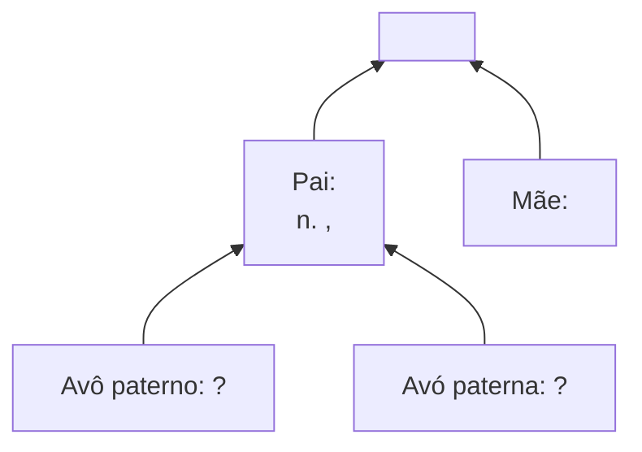

# <Nome Completo do Cliente>
**<data>** · Nível <1|2> · Uso: <conversa / proposta de ...> · Empresa: <...>

## Em 30 segundos
<3 a 5 linhas que dá pra contar numa reunião, sem ler>

## Ganchos de conversa
- <pergunta aberta que convida o cliente a contar a história dele: "Sua família ainda tem ligação com o Vêneto?">
- <curiosidade leve sobre o nome>
- <lugar, prato, festa ou tradição ligada à origem>

## Ideias para a proposta
- <narrativa / conceito ligado à origem>
- <paleta, tipografia, símbolos ou referências culturais>
- <onde NÃO usar (se o tema for sensível)>

## Sobrenomes

### <Sobrenome 1> (paterno|materno)
- **Tipo:** toponímico | patronímico | ofício | apelido | devocional | adotado
- **Significado:** ... (fonte)
- **Origem geográfica:** ... (fonte)
- **Chegada ao Brasil:** ... (fonte)
- **Concentração hoje:** ...
- **Pessoas e lugares ligados ao nome:** ...
- **Confiança:** ✅ / 🟡 / ⚪

### <Sobrenome 2> ...

## Árvore (Nível 2)

| Pessoa | Nascimento | Local | Evento-chave | Fonte | Confiança |
|---|---|---|---|---|---|
| | | | | | |

## Linha do tempo migratória
- <ano> · <evento> · <fonte> · <confiança>

## Perguntas para completar com o cliente
- <o que falta e só a família sabe>

## Fontes
1. <título, link, data de acesso>
